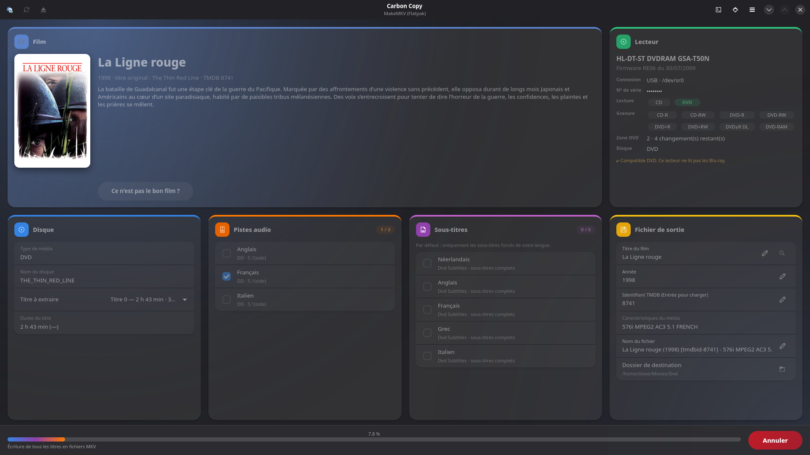
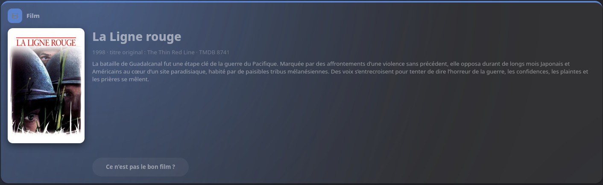
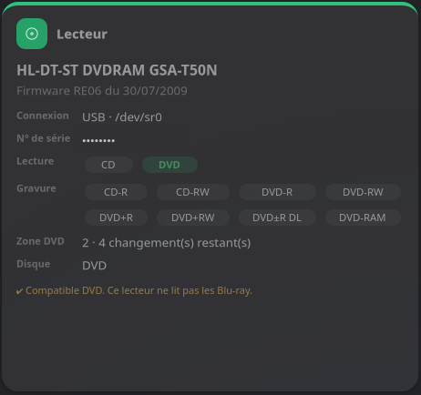
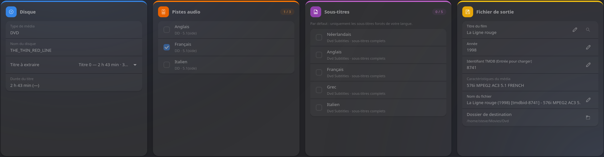

# Carbon Copy


*Une copie conforme de vos disques.*

Interface GTK4 / libadwaita pour **MakeMKV** sous Fedora (GNOME), qui automatise
le rip d'un DVD, d'un Blu-ray ou d'un Blu-ray UHD.



| Fiche du film (couleur tirée de l'affiche) | Lecteur : firmware, capacités, zone DVD |
|---|---|
|  |  |



## Ce que fait l'application

| Étape | Fonctionnement |
|---|---|
| **MakeMKV** | Utilise `makemkvcon` natif s'il est à jour, sinon installe ou met à jour le Flatpak Flathub `com.makemkv.MakeMKV` (mode `--user`, sans sudo). |
| **Clé bêta** | Récupère la clé publique sur le forum officiel au plus une fois par jour, et immédiatement si MakeMKV la déclare expirée. Elle est écrite dans `~/.MakeMKV/settings.conf` (avec une sauvegarde `.bak`) et un toast vous prévient. Une clé achetée (qui ne commence pas par `T-`) n'est jamais modifiée. |
| **Blocage SDF** | MakeMKV 2.x peut se figer à « Balayage des lecteurs CD-ROM » avec certains lecteurs. Si aucun lecteur n'est listé en 60 s, l'application tue le processus, lit l'identifiant du lecteur dans `~/MakeMKV_log.txt` (makemkvcon est lancé avec `--debug`), écrit `sdf_Stop = "<identifiant>"` dans `~/.MakeMKV/settings.conf` et relance la commande. |
| **Film** | Le film est identifié sur TMDB : affiche, titre officiel, année, résumé. Le bouton « Ce n'est pas le bon film ? » ouvre une recherche (titre, année, identifiant ou lien themoviedb.org) ; on peut aussi saisir titre et année à la main. |
| **Nommage** | `Titre (Année) [tmdbid-N] - 576i MPEG2 AC3 5.1 MULTi.mkv` : définition, codecs, canaux et langues sont relevés sur le disque et suivent les pistes cochées. |
| **Lecteur** | Modèle, firmware (et sa date), connexion, n° de série, formats lus et gravés, disque inséré. Bouton Éjecter dans la barre d'en-tête. |
| **Affichage** | Plein écran par défaut (F11 pour basculer, choix mémorisé). Six cases homogènes et colorées tiennent sur un écran ; la couleur de la fiche et du fond est tirée de l'affiche du film. Le journal est un panneau latéral. Le dernier dossier de destination est retenu. |
| **Rapidité** | Dès la fin de l'analyse, MakeMKV copie le titre en arrière-plan pendant que vous vérifiez la fiche : « Lancer le Rip » ne fait plus qu'attendre la fin de la copie puis trier les pistes (option désactivable). L'espace libre est vérifié avant toute copie. |
| **Zone DVD** | Le panneau du lecteur affiche sa zone. Un lecteur sans zone définie oblige MakeMKV à casser les clés de chaque disque : l'analyse peut alors doubler de durée. |
| **Disque** | Détecte l'insertion via l'ioctl `CDROM_DRIVE_STATUS`, puis lance `makemkvcon -r info`. Affiche le type (DVD, Blu-ray ou UHD), le nom et la durée. |
| **Pistes** | Le titre principal (le plus long) est choisi d'office. Sont pré-cochées : l'audio dans votre langue, la VO, et **uniquement les sous-titres forcés** de votre langue. Les sous-titres complets ne sont cochés que si aucune piste audio n'existe dans votre langue. |
| **Nom** | Le nom du disque est nettoyé, puis complété via TMDB si une clé est configurée. Exemple : `Le_Grand_Film_2019.mkv`. |
| **Rip** | MakeMKV extrait **toutes** les pistes (règle `+sel:all`, appliquée temporairement puis restaurée). Ensuite `mkvmerge` ne garde que les pistes cochées et pose les drapeaux `default` et `forced`. |

## Installation

Une seule commande installe tout (paquets système, Rust si besoin, l'application, MakeMKV, l'accès au lecteur) puis lance Carbon Copy. Votre mot de passe administrateur est demandé une seule fois.

```bash
curl -fsSL https://raw.githubusercontent.com/loganxwolverine/carbon-copy/main/install.sh | bash
```

Depuis une copie des sources, c'est la même chose :

```bash
./install.sh
```

Distributions prises en charge :

| Distribution | Versions |
|---|---|
| Fedora | 40 et plus |
| Ubuntu (et Linux Mint 22, Pop!_OS 24.04, elementary OS 8) | 24.04 et plus |
| Debian | 13 « Trixie » et plus |
| Arch Linux (et Manjaro, EndeavourOS) | à jour |
| openSUSE | Tumbleweed, Leap 16 |

Carbon Copy demande GTK 4.14 et libadwaita 1.5 au minimum : Debian 12, Ubuntu 22.04 et Linux Mint 21 sont trop anciennes.

Ce que fait le script :

1. Installe les paquets système : GTK 4 / libadwaita, compilateur, Flatpak, MKVToolNix, eject.
2. Installe Rust avec rustup, dans votre dossier personnel, si celui de la distribution est trop ancien.
3. Compile Carbon Copy et l'installe dans `~/.local` (menu des applications et icône).
4. Installe MakeMKV depuis Flathub, en mode utilisateur. La clé bêta est ensuite gérée par l'application.
5. Prépare l'accès au lecteur : module `sg` chargé à chaque démarrage (Blu-ray) et groupe du lecteur si nécessaire. Dans ce dernier cas, fermez puis rouvrez votre session.
6. Lance l'application.

Relancer le script met l'application à jour. Pour la désinstaller (vos réglages sont conservés, ajoutez `--purge` pour les supprimer aussi) :

```bash
./install.sh --uninstall
```

`./install.sh --help` liste les autres options (`--no-launch`, `--skip-system`, `--skip-flatpak`).

## Tests

```bash
cargo test
```

Le test d'intégration ci-dessous a besoin de `mkvmerge` :

```bash
cargo test -- --ignored
```

Pour tester l'interface sans lecteur physique, placez un faux `makemkvcon` en tête du `PATH`, puis :

```bash
CARBON_COPY_FAKE_DISC=/dev/sr0 cargo run
```

Pour vérifier la mise en page sans écran, `CARBON_COPY_SCREENSHOT=/tmp/capture.png` enregistre une capture de la fenêtre toutes les 10 s (`CARBON_COPY_SCREENSHOT_EVERY` pour changer l'intervalle) :

```bash
CARBON_COPY_SCREENSHOT=/tmp/capture.png cargo run
```

## Configuration

Les préférences sont dans `~/.config/carbon-copy/config.toml` (l'ancien dossier `~/.config/mkv-ripper` est repris automatiquement). On peut aussi les modifier via Menu → Préférences :

- langue préférée ;
- conservation de la VO ;
- clé TMDB (v3 ou jeton v4) ;
- durée minimale des titres ;
- éjection du disque à la fin ;
- source de la clé bêta.

## Organisation du code

```
src/
├── main.rs            point d'entrée (adw::Application)
├── backend.rs         orchestration tokio : démarrage, analyse, rip
├── events.rs          événements tâches de fond → interface (async_channel)
├── process.rs         exécution asynchrone, lecture ligne à ligne, Flatpak
├── drive.rs           détection d'insertion (ioctl), éjection
├── beta_key.rs        récupération et installation de la clé bêta
├── selection.rs       règles de pré-sélection (sous-titres forcés…)
├── metadata.rs        nettoyage du nom de disque, TMDB, nom de fichier
├── remux.rs           mkvmerge : identification, correspondance, remux
├── config.rs          préférences TOML
├── makemkv/
│   ├── robot.rs       parseur du mode robot (MSG/PRGV/DRV/CINFO/TINFO/SINFO)
│   ├── disc.rs        modèle disque / titres / flux
│   ├── cli.rs         sonde, analyse, extraction
│   ├── install.rs     vérification, installation et mise à jour
│   └── settings.rs    lecture et écriture de ~/.MakeMKV/settings.conf
└── ui/
    ├── mod.rs         contrôleur (état + gestion des événements)
    ├── widgets.rs     construction des widgets
    └── prefs.rs       fenêtre de préférences
```
